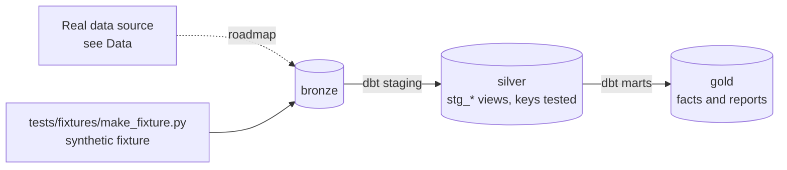

# UK Markets & Macro Lakehouse

[](https://github.com/Saigwe/uk-markets-lakehouse/actions/workflows/ci.yml)

> Official UK statistics and market data on Apache Iceberg: scheduled API pulls, schema evolution and time travel, write-audit-publish so bad data never reaches readers, and every resource in Terraform.

**Author:** Stanley Igwe, Lead Data (Analytics) Engineer · [Portfolio](https://saigwe.github.io)
**Stack:** Apache Iceberg · Apache Spark · Trino · Terraform · dbt Core · DuckDB (CI)
**Status:** 🚧 Scaffolded. Fixture pipeline passes: `dbt build` 12/12. See [Roadmap](#roadmap).

Project 16 of my portfolio plan. At a Big Four firm I delivered BI for a state government, a national oil company, a federal power generator and a development bank. This lakehouse rebuilds that public-finance work on open UK data. This repo rebuilds the problem on public and synthetic data. No employer or client data, code or logic is used.

---

## 90-second summary
| | |
|---|---|
| **Problem** | TODO: one sentence on the business problem. |
| **What I built** | TODO: fill in as the roadmap lands. |
| **Why it matters** | TODO: the decision this enables, in the user's words. |
| **Proof** | TODO: link to [Numbers](#numbers), with every claim reproducible. |

## Architecture


## Data
Real data: [ONS API](https://developer.ons.gov.uk/), [Bank of England database](https://www.bankofengland.co.uk/boeapps/database/) and the [World Bank API](https://datahelpdesk.worldbank.org/knowledgebase/topics/125589). CI uses a synthetic series and observations fixture with planted revisions (later vintages).

| Bronze table (fixture) | Rows |
|---|---|
| `bronze.series` | 4 reference rows |
| `bronze.observations` | one per serie per `MS` period, 2020-01-01 to 2025-06-01 |

## Data model (gold layer, first cut)
| Model | Purpose |
|---|---|
| `fct_observation_latest` | Latest vintage of each observation, plus how many vintages exist. |
| `rpt_revisions` | First estimate vs latest value for observations that were revised. |

## Tests in place
- Staging: `unique` / `not_null` on every key, and `relationships` on every foreign key
- Marts: grain tests (`unique_combination`) and accepted values
- Business rules: `assert_revisions_found`

## Numbers
*(Fill from real runs. Never estimate.)*
| Metric | Value |
|---|---|
| Rows processed (real data) | _tbd_ |
| dbt models / tests | _tbd_ |
| `dbt build` runtime | _tbd_ |

## How to run
Requires **Python 3.12** (what CI uses) and `make`, or run the commands in the `Makefile` by hand.
```bash
python -m venv .venv && source .venv/bin/activate   # Windows: .venv\Scripts\activate
pip install -r requirements.txt
make fixture-all   # synthetic fixture -> dbt build (used in CI)
```

## Roadmap
- [x] Scaffold: synthetic fixture, staging with key tests, first marts and business-rule tests, CI
- [ ] Scheduled pulls from ONS and Bank of England APIs into bronze, keeping every vintage
- [ ] Iceberg tables with schema evolution and time travel
- [ ] Write-audit-publish: write to a branch, run tests, then publish
- [ ] Terraform for storage, catalogue and compute
- [ ] Revision analysis: how far first estimates move
- [ ] Fill in [Numbers](#numbers) and the [design doc](docs/design_doc.md)
- [ ] 3-minute Loom walkthrough

## Interview topics this project prepares
- Lakehouse table formats
- Write-audit-publish
- Infrastructure as code
- Handling revised data

## Data and licence
- **Fixture:** synthetic, generated with a fixed seed by `tests/fixtures/make_fixture.py` from `fixture_spec.yml`. It describes no real company or person.
- **Real data:** see [Data](#data) for each source's own licence and terms.
- **Code:** MIT (see `LICENSE`).
