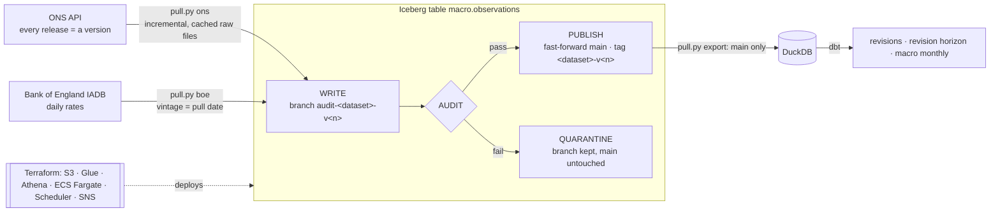

# UK Markets & Macro Lakehouse

[](https://github.com/Saigwe/uk-markets-lakehouse/actions/workflows/ci.yml)
[](https://github.com/Saigwe/uk-markets-lakehouse/actions/workflows/canary.yml)

> Every release ONS has published of monthly GDP since October 2020 (69 vintages), plus CPIH and Bank of England rates, on Apache Iceberg. Each vintage goes through write-audit-publish: written to a branch, audited, then published to `main`. The audits caught real upstream problems and kept them away from readers. Schema evolution, time travel by tag, a revision analysis of how far first GDP estimates move, and the whole AWS stack in Terraform.

**Author:** Stanley Igwe, Lead Data (Analytics) Engineer · [Portfolio](https://saigwe.github.io)
**Stack:** Python · Apache Iceberg (pyiceberg 0.12: branches, tags, schema evolution) · DuckDB · dbt Core (unit tests) · Terraform (AWS: S3, Glue, Athena, ECS Fargate, EventBridge Scheduler) · Docker · GitHub Actions (CI + weekly live canary)
**Status:** Core build complete on live ONS and Bank of England data. See [Roadmap](#roadmap).

Project 16 of my portfolio plan. At a Big Four firm I delivered BI for a state government, a national oil company, a federal power generator and a development bank. This lakehouse rebuilds that public-finance work on open UK data. No employer or client data, code or logic is used.

---

## 90-second summary
| | |
|---|---|
| **Problem** | Official statistics are revised after publication, so a dashboard that overwrites last month's numbers can't say what was known when a decision was made. A malformed release from upstream goes straight to readers. |
| **What I built** | A lakehouse that keeps every vintage of every series in one Iceberg table. Each vintage is written to its own branch, audited (headline present, no duplicates, no lost history, plausible values and moves), then published by fast-forwarding `main` and tagging it. A release that fails stays quarantined on its branch. Pulls are incremental and idempotent. dbt measures revisions on growth rates, so re-referencing an index isn't mistaken for a revision. Terraform defines the AWS deployment. |
| **Why it matters** | Analysts can ask "what did we know on 15 May?" (time travel by tag), and a broken upstream file can't reach a board pack (write-audit-publish). |
| **Proof** | [Numbers](#numbers) from a live pull on 26 October 2026; CI replays the same pipeline offline on every push. |

## Architecture


## Data
| Source | What | Vintages loaded |
|---|---|---|
| [ONS API](https://developer.ons.gov.uk/) `gdp-to-four-decimal-places` | Monthly GDP index by industry, 1997 onwards (headline `A--T`) | 66 published of 69 releases (Oct 2020 to Aug 2026) |
| [ONS API](https://developer.ons.gov.uk/) `cpih01` | CPIH index by COICOP aggregate, 1988 onwards (headline `CP00`) | the last 13 releases |
| [Bank of England database](https://www.bankofengland.co.uk/boeapps/database/) | Bank Rate, 5- and 10-year gilt zero-coupon yields, daily since 2015 | one pull per run |

In total, 965,619 published rows across 80 published vintages (66 GDP, 13 CPIH, 1 BoE). All Open Government Licence data.

## What the audits caught (real upstream problems)
| Release | Problem | Outcome |
|---|---|---|
| GDP v14 | Total GDP (`A--T`) and two other series missing; 296 headline months lost | Quarantined |
| GDP v67 (16 Apr 2026) | Three conflicting duplicate values for production industries (differing in the 4th decimal) | Quarantined |
| GDP v56 (15 May 2025) | Listed as published, but no download exists (HTTP 404) | Skipped; retried every run |
| GDP v6, v7 | 10 garbled rows each (dates like `Se.- T`, no value) | Rows dropped and counted (a warning); release published |
| GDP v15–v61 | Only the 5 headline aggregates, without industry detail; detail returns at v62 | Composition change recorded as a warning |
| CPIH, all releases | Months before a component existed (1988–2000) stored as 0.0 | Mapped to null at ingestion (a zero price index is impossible) |

The audit bounds come from real extremes, not guesses:
- Industry indices may go as low as 1, because accommodation and food services fell to about 10 in April 2020.
- Only the headline has an upper limit, because mining sat above 300 in 1997 after ONS re-referenced the index.
- Headline monthly moves may be up to 30%, because GDP fell about 20% in April 2020.

## Numbers
Live pull on 26 October 2026, on a laptop.

| Metric | Value |
|---|---|
| Published rows / vintages / Iceberg snapshots | 965,619 / 80 / 83 (genesis + 80 published + 2 quarantined) |
| Full GDP pull from cached files | 69 releases through write-audit-publish in 14.5 s; a rerun publishes nothing and takes 1.6 s |
| Export of `main` to DuckDB | 5.7 s |
| dbt build | 23 nodes (7 models, 15 data tests, 1 unit test) in 2.1 s |
| Tests | 6 pytest tests on Iceberg behaviour + dbt tests; all pass |

**How far first estimates of monthly GDP growth move** (`rpt_headline_revisions`, `rpt_revision_by_horizon`), over 71 reference months from August 2020 to June 2026 whose first estimate is in the lakehouse:

| Releases after the first estimate | Months | Mean absolute revision | Mean revision | Direction changed |
|---:|---:|---:|---:|---:|
| 1 | 68 | 0.07 pp | +0.01 pp | 8.8% |
| 3 | 65 | 0.12 pp | +0.03 pp | 10.8% |
| 6 | 62 | 0.14 pp | +0.03 pp | 12.9% |
| 12 | 55 | 0.20 pp | +0.09 pp | 14.5% |
| 24 | 43 | 0.25 pp | +0.09 pp | 11.6% |

- **Latest vs first estimate:** a mean absolute revision of 0.21 pp, and on average +0.10 pp. First estimates understated growth, and 10 of the 71 months changed direction.
- **Timing:** the upward bias is concentrated in the 2020–21 recovery (+0.31 pp on average; August 2020 went from 2.15% to 3.51%). From 2022 the average revision is +0.03 pp (absolute 0.13 pp).
- **CPIH:** none of 12 reference months was revised, matching ONS policy that CPI and CPIH aren't revised. The same model proves it rather than assuming it.

## Iceberg features, and how they're tested
- **Write-audit-publish:** each vintage is appended to `audit-<dataset>-v<n>`, read back and audited against the previous published vintage. Then `main` is fast-forwarded and tagged. Tests: a planted duplicate vintage leaves `main` on the same snapshot and invisible to readers, and lost headline history is blocked.
- **Time travel:** `tbl.scan(snapshot_id=tbl.snapshot_by_name("gdp-to-four-decimal-places-v1").snapshot_id)` returns the table exactly as it was after that release.
- **Schema evolution:** the first Bank of England pull brought a `frequency` column, and the table widened with `union_by_name`. Older snapshots keep their own schema without it (tested), and dbt fills it for ONS rows.
- **Idempotent, incremental pulls:** tagged vintages are skipped, quarantined ones wait for `--retry-quarantined`, and the exit code is non-zero only for a *new* failure (the scheduled job's alert).
- **Offline replay:** every API listing is saved to `versions.json`, so CI and replays run from cached files with `--offline`.

## Terraform
[`terraform/`](terraform) defines the AWS deployment, validated in CI (`fmt -check`, `validate`) but not applied:
- One S3 bucket (`raw/`, `warehouse/`, `athena/`): versioned, KMS-encrypted, public access blocked, with lifecycle rules.
- A Glue database as the Iceberg catalogue, and an Athena workgroup with a 10 GB per-query scan cap.
- ECR, ECS Fargate and EventBridge Scheduler running the pull at 07:30 UK time (ONS publishes at 07:00).
- SNS alerts on a non-zero exit, and least-privilege IAM.

The same code switches to Glue and S3 with `LAKEHOUSE_CATALOG=glue`.

## How to run
Requires **Python 3.12** (what CI uses) and `make`, or run the commands in the `Makefile` by hand.
```bash
python -m venv .venv && source .venv/bin/activate   # Windows: .venv\Scripts\activate
pip install -r requirements.txt
make all            # live pulls (about 2 minutes the first time, seconds after), export, dbt, tests
make fixture-all    # synthetic ONS/BoE-format files, offline, through the same pipeline (CI)
make canary         # the latest live release into a throwaway lakehouse
```

## Roadmap
- [x] Scaffold: fixture, staging with key tests, first marts, CI
- [x] Scheduled pulls from ONS and Bank of England APIs into bronze, keeping every vintage (incremental, idempotent, cached)
- [x] Iceberg tables with schema evolution and time travel (tags per vintage)
- [x] Write-audit-publish: write to a branch, audit, then publish; failed vintages quarantined
- [x] Terraform for storage, catalogue and compute (validated in CI, not applied)
- [x] Revision analysis: how far first estimates move, by horizon, on growth rates
- [ ] Retail sales and labour-market datasets; World Bank series for international comparison
- [ ] Athena views over `main` and a small dashboard
- [ ] 3-minute Loom walkthrough

## Interview topics this project prepares
- Open table formats: snapshots, branches and tags, schema evolution, time travel
- Write-audit-publish and data contracts with an upstream you don't control
- Bitemporal thinking: reference period vs vintage, and "what did we know when?"
- Infrastructure as code and least-privilege IAM for a data platform

## Data and licence
- **ONS and Bank of England data:** © Crown copyright and Bank of England, used under the Open Government Licence v3.0.
- **CI fixture:** synthetic, generated with a fixed seed by `tests/fixtures/make_fixture.py`.
- **Code:** MIT (see `LICENSE`).
